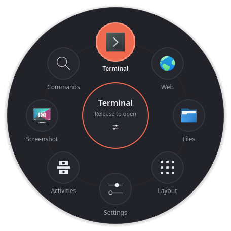
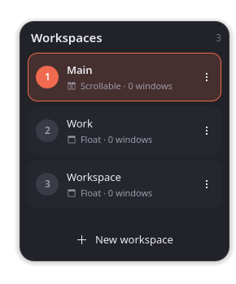
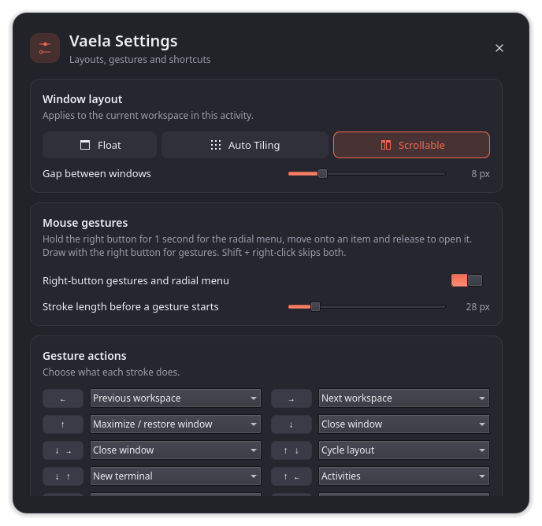
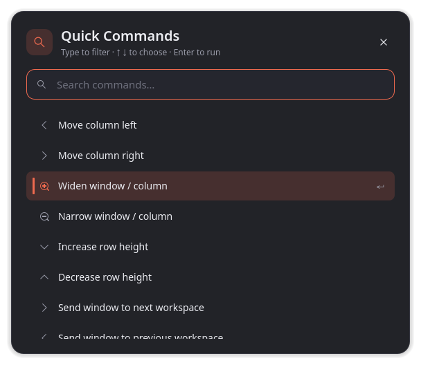

# Vaela

A Wayland desktop that works like the Vivaldi browser: mouse gestures, a radial
menu on a right-click hold, workspaces as vertical tabs, and per-workspace window
layouts that float, tile or scroll. Vaela runs on KDE's KWin and reuses Plasma's
panels, services and settings, and appears as its own **Vaela** session on the
login screen.

<p align="center">
  
  
</p>
<p align="center">
  
  
</p>

## Features

- **Three window layouts per workspace.** *Float* leaves windows where you put
  them, *Auto Tiling* arranges them in a grid, and *Scrollable* puts them in a
  horizontal strip of full-height columns with the focused one in the middle of
  the screen. Each workspace in each activity remembers its own layout.
- **Radial menu.** Hold the right mouse button (half a second by default), move onto
  an item and let go. Applications, shell commands and desktop actions, with your own
  images.
- **Mouse gestures.** Draw with the right button to switch workspaces, close or
  maximize windows, open Quick Commands and more. Every stroke can be rebound.
- **Workspace bar.** Push the pointer against the right edge for your workspaces
  as tabs, with each one's layout and window count.
- **Layout switch.** Move the pointer to the top edge, just left of the top-right
  corner, to change the current workspace's layout.
- **Quick Commands** (F2) and **Vaela Settings** (Meta+Ctrl+S), with direct links
  to Plasma's pages for displays and HDR, sound, printers, power, keyboard,
  mouse, shortcuts and system information.
- **Multiple monitors.** Run Vaela on the primary monitor, on all of them, or on
  the ones you pick; the others behave like plain Plasma.
- **Your own shortcuts.** Every Vaela key can be changed in Settings.

## Requirements

- Fedora 44 or 45, or a Fedora Atomic image based on them (Bazzite, Kinoite, Silverblue), x86_64.
- **KWin 6.7.5,** which both releases ship in their updates. Vaela's KWin plugin uses
  KWin's internal interfaces, so each Vaela build works only with the KWin version it
  was compiled against. The RPM requires that exact version; after a KWin update,
  rebuild Vaela.

## Installing

Build the RPM (see [Building](#building)) or download one from the [releases page](https://github.com/PreCosmos/Vaela/releases).
Pick the file for your Fedora release: `fc45` for Fedora 45, `fc44` for Fedora 44.
`rpm -E %fedora` prints your release. The commands below use the Fedora 45 file.

**Fedora Atomic (Bazzite, Kinoite, Silverblue)**

```bash
rpm-ostree install ./vaela-desktop-0.7.0-1.fc45.x86_64.rpm
```

Replacing an earlier local build (including the old `vela-desktop` package):

```bash
rpm-ostree install --uninstall vela-desktop ./vaela-desktop-0.7.0-1.fc45.x86_64.rpm
```

**Fedora Workstation**

```bash
sudo dnf install ./vaela-desktop-0.7.0-1.fc45.x86_64.rpm
```

Make sure your system is up to date first (`rpm-ostree upgrade` or `sudo dnf upgrade`), so
it has KWin 6.7.5.

Reboot (Atomic) or log out (Workstation), then choose **Vaela** in the session
menu of the login screen. Installing pulls in KWin and the parts of Plasma that
Vaela uses; GNOME or Plasma sessions you already have stay available.

To remove it: `rpm-ostree uninstall vaela-desktop`, or `sudo dnf remove vaela-desktop`.

## Using Vaela

### Layouts

Move the pointer to the **top edge** of the screen, a little to the left of the
top-right corner (which stays free for a maximized window's close button). A short
coral handle there expands into the layout switch: **Float**, **Auto Tiling** or **Scrollable**.
The magnifier opens Quick Commands and the gear opens Vaela Settings.

- **Auto Tiling:** drag a window edge to resize; neighbours share the new boundary.
- **Scrollable:** the focused column sits in the middle of the screen, so new
  windows open centred. Drag a column's edge to change its width; Vaela remembers
  each application's width for the next time it opens.
- **Float:** windows go back to where they were before Vaela arranged them.

Dialogs, pinned, minimized and fullscreen windows are never arranged.

### Workspaces

Push the pointer against the **right edge**. Click a tab to switch, use **⋮** to
rename or remove a workspace, and **New workspace** to add one. Hover a tab to see
its window titles. The gestures → ↑ and ← ↑ send the window under the stroke to the
next or previous workspace.

### Radial menu

Hold the **right mouse button** still for **half a second** (adjustable in Vaela
Settings, from 0.15 to 2 seconds) and the radial menu opens around the pointer. A quicker right-click opens the application's own context
menu as usual, when you release the button.

Keep holding, move onto an item (it grows and the centre reads *Release to open*)
and release the button. Releasing over the centre keeps the menu open so you can
pick an item with a left click instead. **Escape** closes it. **Meta+Ctrl+M** opens
it from the keyboard.

### Mouse gestures

Hold the right button and draw. A quick right-click still opens context menus,
and **Shift+right-click** skips Vaela entirely.

| Stroke | Default action |
|---|---|
| ← / → | Previous / next workspace |
| ↑ | Maximize or restore the window |
| ↓ | Close the window under the stroke |
| ↓ → | Close the window |
| ↑ ↓ | Cycle the layout |
| ↓ ↑ | New terminal |
| ↑ ← | Activities |
| ↑ → | Quick Commands |
| → ↑ / ← ↑ | Send the window to the next / previous workspace |

### Keyboard

| Keys | Action |
|---|---|
| F2 | Quick Commands |
| Meta+Ctrl+S | Vaela Settings |
| Meta+Ctrl+M | Radial menu |
| Meta+Ctrl+Space | Cycle the layout |
| Meta+← / → | Focus the window to the left / right (Scrollable) |
| Meta+Alt+← / → | Focus the previous / next window |
| Ctrl+Meta+← / → | Move the column left / right (Scrollable) |
| Meta+Plus / Minus | Widen / narrow the active column |
| Meta+Ctrl+Alt+arrows | Resize columns and rows |

In Scrollable and Auto Tiling, Vaela's layout keys (Meta+arrows, Meta+Plus/Minus
and Ctrl+Meta+arrows) take priority over Plasma's quick tiling, zoom and workspace
keys that use the same combinations.

Every key in the table can be changed under **Keyboard shortcuts** in Vaela
Settings: click a shortcut and press the new keys (**Esc** cancels, **Backspace**
removes it). If another application or Vaela action already uses them, Vaela says
which and asks before taking them over; the arrow button next to a changed
shortcut puts the default back. The global ones also show up in Plasma's
shortcut settings under *Vaela*.

### Multiple monitors

By default Vaela runs on the **primary monitor**, the one with priority 1 in
System Settings → Display & Monitor, and moves with it when you change which one that is. Under
**Monitors** in Vaela Settings you can pick **All monitors** or **Chosen
monitors** and switch each one on or off.

On each of those monitors you get the layout switch, the workspace bar, mouse
gestures and the radial menu, and windows follow the workspace's layout. On the
others windows float and right-click works as in plain Plasma. Quick Commands and
Settings open on the monitor you are using, if Vaela runs there.

## Customizing

Open **Vaela Settings** (Meta+Ctrl+S, the gear in the layout switch, or the
radial menu) to set the gap between windows, turn gestures on or off, change the
stroke length and the radial menu's hold time, rebind every gesture and keyboard
shortcut, and choose the monitors Vaela runs on.

**Customize radial menu…** edits the radial menu:

- **Add Application** lists installed applications; the name and icon are filled in.
- **Add Command** runs any shell command, optionally in a terminal.
- **Edit** changes the name, command or image. Pick a system icon or your own PNG,
  JPEG, SVG, WebP or BMP; Vaela copies it into `~/.local/share/vaela-shell/radial-icons/`.
- The arrows reorder items and the bin removes one. Menus with more than eight
  items get extra pages.

Settings, gesture bindings, layout keys, the radial menu and remembered column
widths live in `~/.config/vaelarc`; the global shortcuts live with Plasma's, in
`~/.config/kglobalshortcutsrc`.

## Building

Everything builds in a Fedora [distrobox](https://distrobox.it): `vela-dev` for
Fedora 45, with its home in `.devbox/home` inside the checkout. Prefix any script
with `FEDORA=44` to use a Fedora 44 container (`vela-dev-f44`, `.devbox/home-f44`)
and build Fedora 44 RPMs instead.

```bash
./scripts/dev-container.sh
```

```bash
FEDORA=44 ./scripts/dev-container.sh
```

Build the RPM into `rpms/`:

```bash
./scripts/build-rpm.sh
```

Run Vaela in a window on your current desktop, with a throwaway home:

```bash
./scripts/run-nested.sh --fresh
```

Run the tests, including a private software-rendered KWin session:

```bash
./scripts/test-headless.sh
```

## How it works

| Part | What it does |
|---|---|
| `session/startvaela` | Starts Plasma's Wayland session with Vaela's defaults (`/usr/share/vaela/xdg`) layered under your own `~/.config`, and carries settings over from the pre-0.5 "Vela" names |
| `src/plugin.cpp` | KWin plugin: gestures, the right-click hold, layouts, shortcuts, and the `org.vaela.Controller` D-Bus service. It is active only when `VAELA_SESSION=1`, which `startvaela` sets |
| `src/shell.cpp`, `src/*.qml` | `vaela-shell`: the layout switch, workspace bar, radial menu, Quick Commands and Settings, as layer-shell surfaces. It autostarts from `/etc/xdg/autostart` and exits unless the plugin's D-Bus service appears, so other sessions are unaffected |
| `lookandfeel/org.vaela.desktop` | Plasma look-and-feel package with Vaela's colours and first-login panel layout |
| `packaging/vaela-desktop.spec` | The RPM |

## Known limitations

- Each build is tied to one KWin version and has to be rebuilt after KWin updates.
- The workspace bar shows window titles; live thumbnails and workspace stacks are
  not done yet.
- On a Fedora Atomic system rebased from a GNOME image, the new image's system
  accounts may lack `/etc/shadow` entries, which stops Plasma's login manager.
  This comes from the rebase, not from Vaela.

## License

Vaela is free software under the **GNU General Public License, version 2 or (at
your option) any later version** ([`LICENSES/GPL-2.0-or-later.txt`](LICENSES/GPL-2.0-or-later.txt)).
The KWin plugin is built against KWin's own GPL-2.0-or-later code, so Vaela must
be distributed under a GPL-compatible licence; GPL-2.0-or-later matches KWin and
keeps Vaela compatible with Qt's LGPL-3.0. Licensing follows the
[REUSE](https://reuse.software) conventions: source files carry SPDX headers and
`REUSE.toml` covers the rest.

Vaela is an independent project. It is not affiliated with or endorsed by
Vivaldi Technologies, KDE e.V. or Universal Blue. Vivaldi, KDE and Plasma are
trademarks of their respective owners.

## Credits

- [KDE Plasma and KWin](https://kde.org/plasma-desktop/), which Vaela builds on.
- [Vivaldi](https://vivaldi.com), whose gestures and tab bar inspired the design.
- [Kando](https://kando.menu), whose menu editor inspired the radial menu editor.
